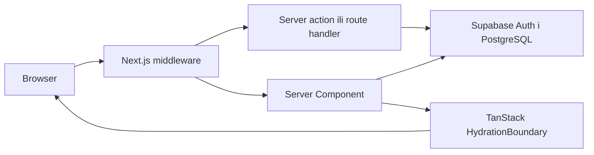

# TreuPlate

## Opis

TreuPlate je aplikacija za profesionalne kuhinje. U njoj se vode sastojci,
recepti, nabavne cene, zalihe, priprema smene i nedeljni raspored. Kalkulatori
računaju trošak porcije i skaliraju količine za drugi broj porcija.

## Pravni dokumenti i pomoć

Poslednja izmena sva četiri nacrta je 24. novembra 2026. godine.

- Uslovi korišćenja na `/pravila-koriscenja`
- Politika privatnosti na `/privatnost`
- Politika povraćaja na `/povracaj-novca`
- Česta pitanja na `/faq`

Uputstvo za evidenciju prihvatanja, izbor politike povraćaja i pregled nacrta je u [dokumentaciji P2](docs/legal.md).

## Stack

- Next.js 15 (App Router), React 19 i TypeScript
- Tailwind CSS 4, Lucide i Inter
- Supabase Auth, PostgreSQL, Realtime i Edge Functions
- TanStack Query, IndexedDB (`idb-keyval`) i Serwist za PWA
- Zod za validaciju i Vitest za testove

## Arhitektura



- Middleware dopušta javne putanje iz `lib/auth/routes.ts`. Privatne HTML navigacije proverava preko Auth-a. Privatne mutacije proveravaju korisnika u server action-u ili handler-u i validiraju ulaz Zod šemom.
- Javni Supabase klijent koristi korisničku sesiju. Svaka tabela sa korisničkim podacima ima RLS. Pravila vezuju red za `auth.uid()`, vlasništvo lokala ili aktivno članstvo. Politike upisa proveravaju stanje reda posle izmene pomoću `WITH CHECK`.
- Ograničen pristup važi i za direktne pozive iz browsera. RPC koristi ulogu pozivaoca gde je moguće. Servisni ključ ostaje na serveru, a RPC sa `SECURITY DEFINER` proverava identitet, obim pristupa i dozvolu izvršavanja.
- Promene šeme idu u nove, vremenski prefiksirane migracije. SQL test proverava da dva korisnika imaju izolovane podatke. [Audit arhitekture](docs/architecture-audit.md) · [SQL test](supabase/tests/rls.test.sql)

## Preduslovi

- Node.js **22** i Git.
- pnpm **9.15.0**, prema polju `packageManager` u `package.json`. Po potrebi instalirajte ga komandom `npm install -g pnpm@9.15.0`.
- Supabase CLI dostupan kao `supabase` i pokrenut Docker Desktop ili kompatibilan Docker engine. Proverite `supabase --version` i `docker info`. [Instalacija Supabase CLI-ja](https://supabase.com/docs/guides/local-development/cli/getting-started)
- Mrežni pristup za pakete, Supabase kontejnere i Inter koji Next.js preuzima preko `next/font/google`.

## Lokalno pokretanje

1. Klonirajte repozitorijum i otvorite njegov koren. Instalirajte zavisnosti i kopirajte šablon okruženja.

   ```bash
   pnpm install --frozen-lockfile
   cp .env.example .env.local
   ```

   U PowerShell-u koristite `Copy-Item .env.example .env.local`.

2. Ako `supabase/config.toml` još nije kreiran, pokrenite `supabase init`. U
   odeljku `[auth]` tog fajla podesite adresu aplikacije i dozvoljene povratne URL-ove.

   ```toml
   site_url = "https://dlztt72p-3000.euw.devtunnels.ms/"
   additional_redirect_urls = [
     "https://dlztt72p-3000.euw.devtunnels.ms//auth/callback?next=/login",
     "https://dlztt72p-3000.euw.devtunnels.ms//auth/callback?next=/reset-password",
   ]
   ```

3. Pokrenite lokalni Supabase. Pri prvom pokretanju CLI primenjuje migracije iz
   `supabase/migrations/`. [Lokalni Supabase](https://supabase.com/docs/guides/local-development/cli/getting-started)

   ```bash
   supabase start
   supabase status
   ```

   Ako CLI ne pronalazi Docker, instalirajte ga ili proverite da je dostupan
   u istom terminalu. Pokrenite Docker engine i potvrdite vezu komandom
   `docker info` pre ponovnog pokušaja.

4. U `.env.local` zamenite vrednosti iz šablona podacima **lokalnog** Supabase-a.
   Izlaz `supabase status` prikazuje API adresu i ključeve.

   | Promenljiva | Lokalna vrednost |
   | --- | --- |
   | `NEXT_PUBLIC_SUPABASE_URL` | Adresa lokalnog API-ja, po pravilu `http://127.0.0.1:54321` |
   | `NEXT_PUBLIC_SUPABASE_ANON_KEY` | Lokalni publishable ili `anon` ključ |
   | `NEXT_PUBLIC_SITE_URL` | `https://dlztt72p-3000.euw.devtunnels.ms` |
   | `SUPABASE_SERVICE_ROLE_KEY` | Lokalni `service_role` ključ za serversko brisanje naloga |

5. Dok lokalna baza radi, generišite tipove i pokrenite aplikaciju.

   ```bash
   pnpm db:types
   pnpm dev
   ```

6. Otvorite [https://dlztt72p-3000.euw.devtunnels.ms/](https://dlztt72p-3000.euw.devtunnels.ms/) i registrujte se. Ako je
   uključena potvrda adrese, otvorite lokalno sanduče za testnu poštu sa adrese
   koju ispisuje `supabase status`, pa kliknite na vezu za potvrdu. Za osnovni
   razvoj dovoljan je nalog prijavljen e-poštom. Google prijava i Paddle naplata
   traže zasebnu konfiguraciju provajdera.

## Skripte

| Komanda | Namena |
| --- | --- |
| `pnpm install --frozen-lockfile` | Instalira verzije iz `pnpm-lock.yaml`. Dostupan je i alias `pnpm pkg:frozen`. |
| `pnpm dev` | Razvojni server sa Turbopack-om. |
| `pnpm build` / `pnpm start` | Gradi i pokreće produkcijsku verziju sa servisnim radnikom. |
| `pnpm lint` | Proverava TypeScript i React izvore ESLint-om. |
| `pnpm test` / `pnpm test:watch` | Pokreće Vitest jednom ili prati izmene. |
| `pnpm test:coverage` | Meri pokrivenost proračuna u `lib/calc`. |
| `pnpm db:types` | Generiše `lib/supabase/database.types.ts` iz pokrenute lokalne baze. |
| `pnpm fonts:og` | Preuzima Inter Latin i Latin Extended za Open Graph i Twitter slike u `assets/fonts/`. |
| `pnpm pkg:install` / `pnpm pkg:audit` | Instalira zavisnosti ili prijavljuje bezbednosne nalaze od nivoa `high`. |

## Testovi

```bash
pnpm lint
pnpm test
pnpm test:coverage
```

Vitest koristi testne podatke i zamene za Supabase tamo gde su potrebne. Za
SQL testove pokrenite `supabase test db` dok lokalna baza radi. Za
PWA proveru koristite `pnpm build` pa `pnpm start`. Prijavite korisnika, otvorite
recepte, sastojke i šablon smene, odjavite se, pa se prijavite kao drugi
korisnik. U DevTools proverite da lokalno skladište i offline prikaz sadrže
samo podatke novog korisnika. [Ponašanje bez mreže](docs/offline.md)

Test opterećenja je u `load/dashboard.js` i pokreće se na izdvojenom staging projektu. [K6 konfiguracija i rezultati](docs/k6-dashboard.md)

## CI

[GitHub Actions](.github/workflows/ci.yml) pokreće **Quality checks** za svaki
pull request i push na `main`. Posao koristi Node 22, verziju pnpm-a iz
`package.json`, zamrznuti lockfile, lint, testove i produkcijski build sa
primerima javnih promenljivih.

Da biste proveru učinili obaveznom, prvo pustite uspešan PR. Zatim otvorite
**Settings → Branches**, uredite pravilo za `main`, uključite **Require status
checks to pass before merging**, izaberite **Quality checks** i sačuvajte.
GitHub prikazuje provere koje su uspešno završene u prethodnih sedam dana.
[GitHub zaštita grana](https://docs.github.com/en/repositories/configuring-branches-and-merges-in-your-repository/managing-protected-branches/managing-a-branch-protection-rule)

Za proveru tipova uklonite komentare iz posla `supabase-types`. On pokreće
lokalnu bazu, regeneriše tipove i proverava razliku u odnosu na Git. Ako
repozitorijum već sadrži `supabase/config.toml`, uklonite korak `supabase init`.
[Supabase provera generisanih tipova](https://supabase.com/docs/guides/deployment/ci/generating-types)

## Deploy

1. U korenu repozitorijuma povežite ciljni Supabase projekat i primenite
   migracije. Za produkciju koristite odgovarajući projektni ID.

   ```bash
   supabase login
   supabase link --project-ref <project-ref>
   supabase db push
   ```

   [Supabase okruženja](https://supabase.com/docs/guides/deployment/managing-environments)
2. U hostingu podesite iste promenljive kao lokalno sa produkcijskim
   vrednostima. `NEXT_PUBLIC_SITE_URL` je javna HTTPS adresa aplikacije bez završne kose crte.
   `SUPABASE_SERVICE_ROLE_KEY` ostaje u serverskom okruženju. U Supabase Auth
   podesite tu adresu i dozvolite povratne URL-ove `/auth/callback` za prijavu
   i resetovanje lozinke, sa parametrima iz lokalnog primera.
3. Podesite Node 22, `pnpm install --frozen-lockfile` i `pnpm build`. Za
   sopstveni Node server koristite `pnpm start`. [Next.js deploy](https://nextjs.org/docs/15/app/getting-started/deploying)
4. Za naplatu postavite Paddle tajne i objavite odgovarajuće funkcije. [Podešavanje Paddle sandbox-a i provere naplate](docs/billing.md)
   [Podešavanje Edge Functions](supabase/functions/README.md)

Znak TreuPlate uređujte u `components/brand/mark.mjs`. Zatim pokrenite
`node scripts/generate-pwa-icons.mjs <verzija>` (npr. `v3`). Skripta ažurira
`lib/config/pwa-icons.json` i `public/manifest.json`, generiše SVG i PNG ikone
i briše stare verzionisane ikone iz `public/icons/`. CI proverava da verzije u oba fajla
ostanu usklađene (`pnpm check:pwa-icons`).

## Struktura foldera

| Folder | Sadržaj |
| --- | --- |
| `app/` | App Router stranice, Auth, metapodaci i servisni radnik. |
| `components/` | Zajedničke UI komponente, navigacija i ekrani. |
| `lib/` | Proračuni, i18n, validacija, Supabase i offline skladište. |
| `supabase/` | SQL migracije, Edge Functions i SQL testovi. |
| `public/` | PWA manifest i verzionisane ikone. |
| `assets/fonts/` | Lokalni fontovi za slike pri deljenju. |
| `scripts/` | Alati za PWA ikone i Open Graph fontove. |
| `load/` | k6 scenario za HTTP čitanja na staging-u. |
| `docs/` | Tehničke beleške i snimci ekrana. |
| `.github/workflows/` | CI provere. |

[Smernice za dizajn](DESIGN.md) · [Istorija promena](CHANGELOG.md)

## Vlasnik i licenca

- **Vlasnik** — _biće dodat_.
- **Licenca** — _čeka odluku vlasnika_.
